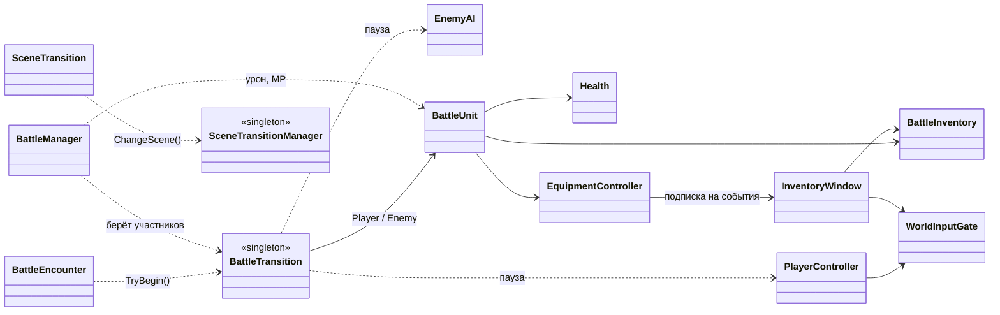
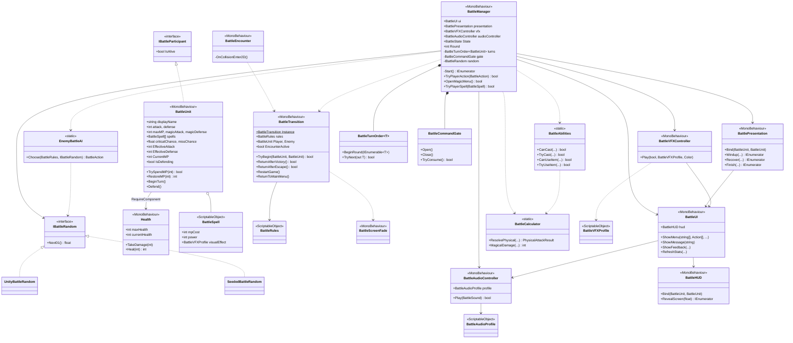
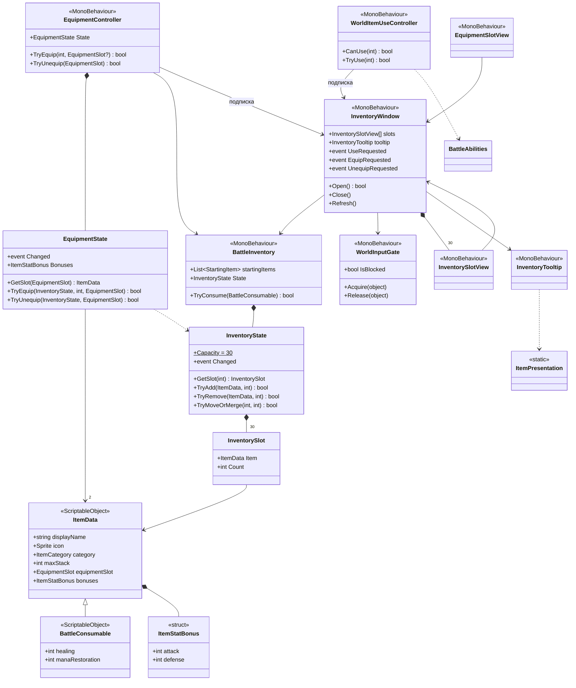
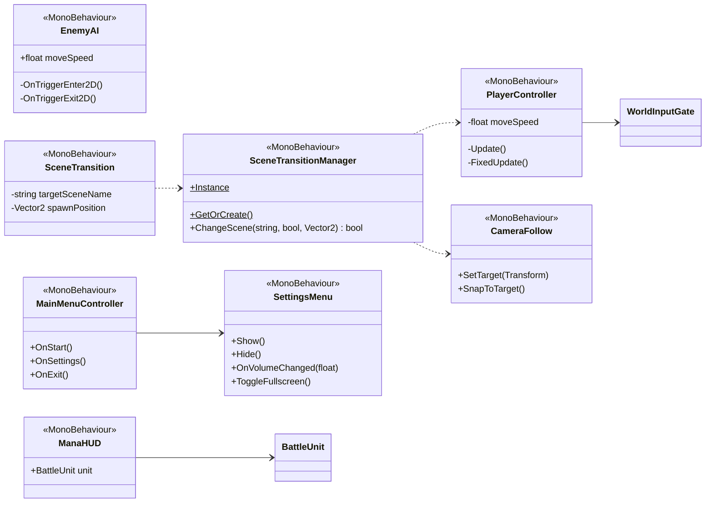

# 3. Диаграмма классов

Диаграммы в формате **Mermaid** — GitHub рисует их автоматически. Также можно вставить код в [mermaid.live](https://mermaid.live).

Обозначения:

| Стрелка | Значение |
|---|---|
| `A --\|> B` | A наследуется от B |
| `A ..\|> B` | A реализует интерфейс B |
| `A *-- B` | A создаёт и хранит B внутри себя (композиция) |
| `A --> B` | A хранит ссылку на B (поле в Inspector или `GetComponent`) |
| `A ..> B` | A просто использует B (вызов метода, `Instance`) |

Стереотипы: `<<MonoBehaviour>>` — компонент на объекте, `<<ScriptableObject>>` — файл с данными, `<<static>>` — статический класс.

Показаны главные поля и методы; полный список — в [справочнике](08-scripts-reference.md).

---

## 3.1 Общая картина

## 3.2 Бой

## 3.3 Инвентарь и экипировка

## 3.4 Мир, сцены, меню

Перечисления (`enum`): `BattleAction` {Attack, Defend, Magic, Flee}, `BattleState` {Starting, Resolving, AwaitingPlayer, Victory, Defeat, Escaped}, `ItemCategory` {Consumable, Weapon, Armor}, `EquipmentSlot` {Weapon, Chest}, `BattleSound`, `SpritePose`, `BattleVFXShape`, `BattleTarget`, `BattleEffect`, `ItemUseLocation`.
