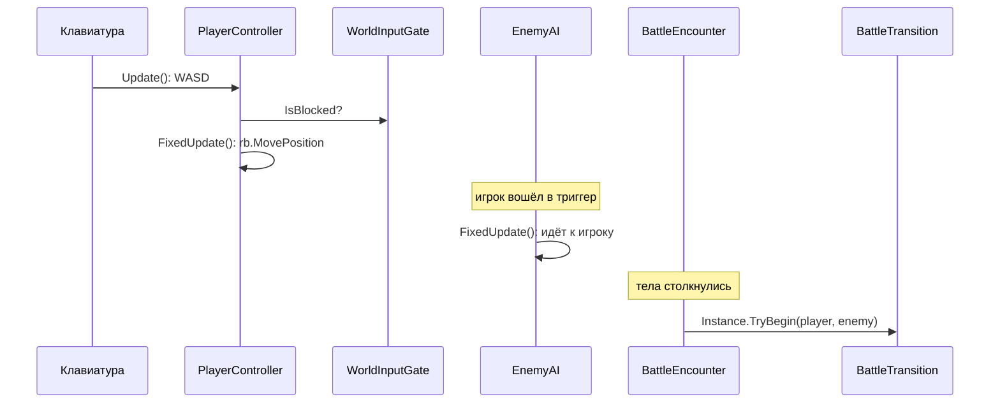

# 4. Мир: движение, камера, враг, начало боя

Скрипты: `PlayerController`, `CameraFollow`, `EnemyAI`, `Health`, `ManaHUD`, `WorldInputGate`, `BattleEncounter`.

## 4.1 Движение игрока — `PlayerController`

Ввод и физика разделены по двум методам жизненного цикла:

```csharp
private void Update()            // каждый кадр: прочитать клавиатуру
{
    if (inputGate != null && inputGate.IsBlocked) { moveInput = Vector2.zero; return; }
    // WASD / стрелки → moveInput, включить анимацию ходьбы, развернуть спрайт
}

private void FixedUpdate()       // шаг физики: сдвинуть Rigidbody2D
{
    Vector2 newPosition = rb.position + moveInput * moveSpeed * Time.fixedDeltaTime;
    rb.MovePosition(newPosition);
}
```

- Компоненты (`Rigidbody2D`, `Animator`, `SpriteRenderer`, `WorldInputGate`) находятся через `GetComponent` в `Start`.
- Анимация: при движении включается `Animator` и параметр `isMoving = true`; в покое Animator выключается и показывается спрайт `idleSprite`.
- Поворот: `SpriteRenderer.flipX` — отразить картинку влево/вправо.

## 4.2 Блокировка движения — `WorldInputGate`

Маленький «замок»: хранит множество владельцев (`HashSet<object>`). Пока хоть кто-то держит замок — игрок стоит.

```csharp
public bool IsBlocked => owners.Count > 0;
public void Acquire(object owner) { owners.Add(owner); }
public void Release(object owner) { owners.Remove(owner); }
```

`InventoryWindow.Open()` вызывает `gate.Acquire(this)`, `Close()` — `gate.Release(this)`. `PlayerController` проверяет `IsBlocked`. Окно и контроллер движения **не знают друг о друге** — общаются через замок.

## 4.3 Камера — `CameraFollow`

В `LateUpdate` (после того как игрок уже сдвинулся в этом кадре) плавно подтягивает камеру к цели:

```csharp
Vector3 desired = target.position + offset;              // offset.z = -10, камера «перед» сценой
transform.position = Vector3.Lerp(transform.position, desired, smoothSpeed * Time.deltaTime);
```

`SetTarget` / `SnapToTarget` вызывает `SceneTransitionManager` после перехода в новую сцену.

## 4.4 Враг — `EnemyAI`

У скелета **два коллайдера**: большой триггер (зона видимости) и обычный (тело).

```
Игрок входит в триггер → OnTriggerEnter2D → isAggro = true, запомнить transform игрока
FixedUpdate: если isAggro → rb.MovePosition(в сторону игрока)
Игрок вышел из триггера → OnTriggerExit2D → isAggro = false, остановиться
```

## 4.5 Здоровье — `Health`

**Единственное место, где хранится HP** — и в мире, и в бою. `BattleUnit` не хранит HP, а читает его: `IsAlive => Health.currentHealth > 0`.

- `TakeDamage(int)` — уменьшить HP (не ниже 0) и обновить полоску/текст.
- `Heal(int)` — вылечить (не выше максимума, мёртвого не лечит), вернуть, сколько реально вылечено.
- Ссылки на UI (`hpSlider`, `hpText`) заданы в Inspector.

`ManaHUD` — полоса маны в мире. Каждый кадр сравнивает `unit.CurrentMP` с показанным значением и обновляет `Slider` только при изменении.

## 4.6 Начало боя — `BattleEncounter`

Висит на скелете. При физическом касании:

```csharp
private void OnCollisionEnter2D(Collision2D collision)
{
    BattleUnit player = collision.gameObject.GetComponent<BattleUnit>();   // у того, кто врезался
    BattleTransition.Instance.TryBegin(player, GetComponent<BattleUnit>()); // мой BattleUnit
}
```

Скелет не загружает сцену сам — он только **просит** синглтон `BattleTransition`. Что происходит дальше — в [05-battle.md](05-battle.md).

## 4.7 Схема


