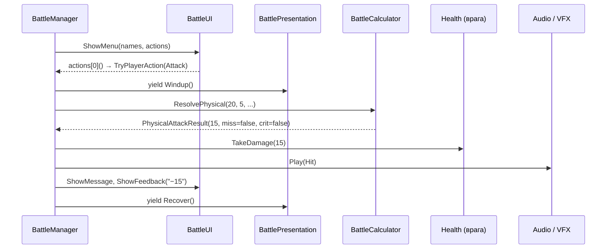

# 5. Бой

Самая большая система. Разделена на роли:

| Роль | Скрипты | Что делает |
|---|---|---|
| **Переход** | `BattleTransition`, `BattleScreenFade` | открыть/закрыть бой, спрятать/вернуть мир |
| **Режиссёр** | `BattleManager` | ведёт ходы, меняет HP/MP, решает исход. **Единственный, кто меняет состояние боя** |
| **Правила** (чистый C#) | `BattleCalculator`, `BattleAbilities`, `EnemyBattleAI`, `BattleTurnOrder`, `BattleCommandGate` | формулы, проверки, очередь ходов |
| **Данные** | `BattleUnit`, `Health`, `BattleRules`, `BattleSpell` | характеристики и настройки |
| **Показ** | `BattleUI`, `BattleHUD`, `BattlePresentation`, `BattleVFXController`, `BattleAudioController` | текст, меню, полоски, анимации, эффекты, звук. **Ничего не решают** |

## 5.1 Переход в бой — `BattleTransition`

Синглтон в мире (`BattleTransition.Instance`). `TryBegin(player, enemy)`:

1. Проверяет, что бой ещё не идёт и оба живы.
2. Запоминает `Player`, `Enemy`, ставит `EncounterActive = true`.
3. **Выключает** `PlayerController` и `EnemyAI` (`behaviour.enabled = false`), останавливает их `Rigidbody2D`.
4. Запускает корутину `EnterBattle()`:
   - затемняет экран;
   - прячет все объекты мира (`SetActive(false)`);
   - загружает `BattleScene` **Additive** — поверх мира.

> **Ключевая идея:** игрок и скелет **не копируются** в сцену боя. Мир просто спрятан, а `BattleManager` работает с теми же объектами `BattleUnit` и `Health`. Поэтому урон, потраченная мана и экипировка сохраняются после боя автоматически.

Пока `EncounterActive == true`, сами отказываются работать: окно инвентаря, экипировка, использование зелий, переход в пещеру.

## 5.2 Цикл боя — `BattleManager.Start()`

`Start` объявлен как `IEnumerator` — **весь бой одна корутина**:

```csharp
private IEnumerator Start()
{
    transition = BattleTransition.Instance;
    Player = transition.Player;  Enemy = transition.Enemy;  rules = transition.rules;
    ui.ShowUnits(Player, Enemy);  presentation.Bind(Player, Enemy);

    while (Player.IsAlive && Enemy.IsAlive)              // раунды
    {
        turns.BeginRound(new[] { Player, Enemy });       // игрок всегда первый
        while (turns.TryNext(out actor))                 // ходы внутри раунда
        {
            if (actor == Player)
            {
                ShowMainMenu();                          // показать Attack/Magic/Defend/Flee
                while (!pendingAction.HasValue)          // ЖДАТЬ, пока игрок нажмёт кнопку
                    yield return null;
            }
            else
                pendingAction = EnemyBattleAI.Choose(rules, random);

            yield return presentation.Windup(...);       // анимация замаха
            // ... применить действие: урон / магия / защита / побег
            yield return presentation.Recover(...);      // анимация удара
        }
    }
    // победа или поражение → меню результата
}
```

`while (...) yield return null;` — «ждать по кадру, пока условие не выполнится». Это позволяет писать ожидание ввода игрока линейно, без callback-ада.

## 5.3 Как кнопка доходит до BattleManager

`BattleUI` — универсальное меню. Оно ничего не знает о бое: получает **массивы подписей и делегатов**.

```csharp
// BattleManager.ShowMainMenu()
string[] names  = { "Attack", "Magic", "Defend", "Flee" };
Action[] actions =
{
    () => TryPlayerAction(BattleAction.Attack),
    () => OpenMagicMenu(),
    () => TryPlayerAction(BattleAction.Defend),
    () => TryPlayerAction(BattleAction.Flee)
};
ui.ShowMenu(names, actions);
```

```
Игрок нажал Enter → BattleUI.Update() → Invoke(selected) → actions[i]()
  → BattleManager.TryPlayerAction(Attack)
       → gate.TryConsume()       // BattleCommandGate: принять только ОДНУ команду за ход
       → pendingAction = Attack  // цикл в Start() перестаёт ждать и продолжает
```

`BattleCommandGate` защищает от двойного нажатия: открывается в начале хода игрока, `TryConsume()` срабатывает один раз и закрывает «ворота».

## 5.4 Действия и формулы

**Attack** → `BattleCalculator.ResolvePhysical(...)`:
1. Промах с шансом `missChance` (5%) → 0 урона.
2. Крит с шансом `criticalChance` (10%) → множитель `1.5`.
3. `урон = max(1, ATK − DEF) × крит × (0.5 если цель в защите)`, округление вверх.
4. `BattleManager` вызывает `target.Health.TakeDamage(урон)`.

**Magic** → `BattleAbilities.TryCast(...)`: проверить MP → `TrySpendMP(8)` → `урон = max(1, power + MATK − MDEF)` → `TakeDamage`.

**Defend** → `actor.Defend()` — флаг `IsDefending` до начала следующего хода (`BeginTurn()` его снимает).

**Flee** → всегда успешно → `transition.ReturnAfterEscape()`.

**Враг** → `EnemyBattleAI.Choose`: 20% (`enemyDefendChance`) — Defend, иначе Attack.

Пример с реальными значениями:
- Игрок бьёт скелета: ATK 15 + меч 5 = **20** − DEF 5 = **15** урона (крит — 23).
- Fire: 10 + MATK 12 − MDEF 3 = **19** урона.
- Скелет бьёт игрока в броне: ATK 12 − (DEF 8 + броня 4) = 0 → минимум **1**.

**Эффективная атака** считается «на лету»: `BattleUnit.EffectiveAttack = attack + EquipmentController.State.Bonuses.attack`. Экипировка влияет на бой без единого лишнего вызова.

**Случайность через интерфейс** `IBattleRandom`: в игре — `UnityBattleRandom` (обёртка над `UnityEngine.Random`), в тестах — `SeededBattleRandom` с фиксированным seed, чтобы результат был предсказуемым. Это пример **внедрения зависимости** (`SetRandomSource`).

## 5.5 Кто что показывает

| Скрипт | Делает | Как получает данные |
|---|---|---|
| `BattleUI` | текст сообщений, меню команд, всплывающий урон, экран результата | вызовы от `BattleManager` |
| `BattleHUD` | полоски HP/MP с плавной анимацией, подсветка выбранной команды | каждый кадр в `Update` читает `BattleUnit` |
| `BattlePresentation` | замах, рывок, тряска портретов, позы | корутины `Windup` / `Recover` / `Finish` |
| `BattleVFXController` | анимация огня и частицы | `Play(onPlayer, spell.visualEffect, color)` |
| `BattleAudioController` | звуки действий | `Play(BattleSound.Attack)` → клип из `BattleAudioProfile` |

Ссылки между ними заданы в **Inspector**: все компоненты висят на одном объекте `BattleManager` в `BattleScene`.

**Звуки.** Код просто вызывает `audioController.Play(BattleSound.Fire)`, а какой файл прозвучит — решает ассет `DefaultBattleAudio` (`BattleAudioProfile`). Сейчас назначены:

| Действие | `BattleSound` | Файл в `Assets/Sounds/SFX/` |
|---|---|---|
| Attack | `Attack` | `10_Battle_SFX/22_Slash_04` |
| Defend | `Defend` | `10_Battle_SFX/39_Block_03` |
| Flee | `Flee` | `10_Battle_SFX/51_Flee_02` |
| Magic Fire | `Fire` | `8_Atk_Magic_SFX/04_Fire_explosion_04_medium` |

Остальные события (`Hit`, `Miss`, `Victory`...) вызываются, но клипы им не назначены — `Play` просто ничего не делает. Чтобы добавить звук, не нужен код: перетащить файл в поле ассета в Inspector.

## 5.6 Выход из боя

| Исход | Метод `BattleTransition` | Что происходит |
|---|---|---|
| Победа | `ReturnAfterVictory()` | выгрузить `BattleScene`, вернуть мир, **скелет выключается**. Перед этим `BattleManager` выдаёт лут (см. ниже) |
| Побег | `ReturnAfterEscape()` | вернуть мир, `EnemyAI` выключен на 3 с, игрока отодвигают на 2 единицы от скелета (чтобы бой не начался сразу снова) |
| Поражение | `RestartGame()` / `ReturnToMainMenu()` | загрузить сцену заново, через `BattleScreenFade` (затемнение переживает загрузку) |

## 5.7 Лут после победы — `LootDrop`

На враге может висеть компонент `LootDrop` с полями `item` (ассет `ItemData`) и `count`. Сейчас он есть только у `BossSkeleton` в `Dungeon`: `item = Excalibur`.

```csharp
// BattleManager, ветка победы
LootDrop loot = Enemy.GetComponent<LootDrop>();       // есть ли у врага лут?
if (loot != null)
{
    victoryMessage = victoryMessage + " " + loot.GiveTo(Player);   // "You found Excalibur!"
}
```

`GiveTo` кладёт предмет через `Player.Inventory.TryAdd(...)`. Если сумка полна — предмет теряется, и об этом пишется в сообщении.

Это пример подхода «больше объектов, меньше кода»: чтобы сделать лут другому врагу, достаточно добавить ему компонент `LootDrop` в Inspector и выбрать предмет — код менять не нужно.

## 5.8 Схема одного хода


