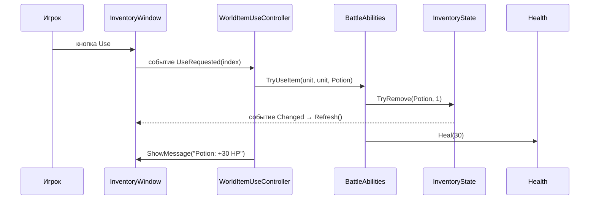

# 6. Инвентарь и экипировка

Хороший пример разделения на **модель → контроллер → представление**:

| Слой | Скрипты | Знает о Unity? |
|---|---|---|
| **Данные предметов** | `ItemData`, `BattleConsumable` (ScriptableObject), `ItemStatBonus` (struct) | только как файлы-ассеты |
| **Модель** | `InventoryState`, `InventorySlot`, `EquipmentState` | **нет** — обычные C#-классы |
| **Компоненты-владельцы** | `BattleInventory`, `EquipmentController`, `WorldItemUseController` | да, висят на Player |
| **Представление (UI)** | `InventoryWindow`, `InventorySlotView`, `EquipmentSlotView`, `InventoryTooltip`, `ItemPresentation` | да |

## 6.1 Предметы — `ItemData` и `BattleConsumable`

`ItemData` — описание предмета: имя, иконка, категория (`Consumable` / `Weapon` / `Armor`), размер стопки, слот экипировки, бонусы `attack` / `defense`.

`BattleConsumable : ItemData` — **наследник** для расходников: добавляет `healing` и `manaRestoration`. Зелье `Potion` — это `BattleConsumable` с `healing = 30`.

В инвентаре хранится не копия предмета, а **ссылка на ассет** + количество.

## 6.2 Модель — `InventoryState`

Обычный класс (не MonoBehaviour), массив из 30 `InventorySlot` (каждый: `ItemData Item`, `int Count`).

| Метод | Что делает |
|---|---|
| `TryAdd(item, amount)` | сначала докладывает в существующие стопки, потом в пустые слоты. Если не влезает — **ничего не меняет** и возвращает `false` |
| `TryRemove(item, amount)` | убирает, если хватает |
| `TryMoveOrMerge(from, to)` | перенести / объединить стопки / поменять местами (drag & drop) |
| `Count(item)` | сколько всего таких предметов |
| `event Action Changed` | вызывается после **каждого** успешного изменения |

Паттерн `bool TryXxx(...)`: метод либо полностью выполняется и возвращает `true`, либо ничего не меняет и возвращает `false`. Так не бывает «половины операции».

## 6.3 Владелец — `BattleInventory`

Компонент на Player. В Inspector задан список `startingItems` (меч, броня, 3 зелья). При первом обращении к свойству `State` создаёт `InventoryState` и кладёт в него стартовые предметы (**ленивая инициализация** — объект создаётся, когда он впервые нужен).

## 6.4 Экипировка — `EquipmentState` + `EquipmentController`

`EquipmentState` — модель: 2 слота (`Weapon`, `Chest`).
- `TryEquip(inventory, index, slot)` — забрать предмет из ячейки сумки в слот; если в слоте что-то было — вернуть это в сумку на то же место.
- `TryUnequip(inventory, slot)` — снять в сумку (если в сумке есть место).
- `Bonuses` — сумма бонусов надетых предметов. Отсюда её читает `BattleUnit.EffectiveAttack/EffectiveDefense`.

`EquipmentController` — компонент, связывает модель с окном и запрещает менять экипировку во время боя.

## 6.5 Окно — `InventoryWindow` и события

Окно **ничего не меняет само**. Когда игрок нажимает кнопку, окно **публикует событие**, а логику выполняет тот, кто подписан:

```csharp
// InventoryWindow (издатель)
public event Action<int> UseRequested;
public event Action<int, EquipmentSlot?> EquipRequested;
public event Action<EquipmentSlot> UnequipRequested;
public Func<int, bool> CanUseSelection;      // «можно ли использовать?» — спросить у кого-то
```

```csharp
// EquipmentController (подписчик)
private void OnEnable()
{
    window.EquipRequested   += HandleEquip;
    window.UnequipRequested += HandleUnequip;
    State.Changed           += window.Refresh;   // экипировка изменилась → перерисовать окно
}
private void OnDisable()
{
    window.EquipRequested   -= HandleEquip;
    window.UnequipRequested -= HandleUnequip;
    State.Changed           -= window.Refresh;
}
```

```csharp
// WorldItemUseController (подписчик)
private void OnEnable()
{
    window.UseRequested     += HandleUse;
    window.CanUseSelection   = CanUse;          // окно спросит, активна ли кнопка Use
}
```

Зачем так: окно можно переиспользовать (например, в будущем для сундука), а правила использования и экипировки меняются, не трогая UI.

## 6.6 Ячейки, перетаскивание, подсказка

- `InventorySlotView` — одна ячейка (их 30). При старте окно вызывает `slots[i].Bind(this, i)` — ячейка запоминает окно и свой номер.
- Ячейка реализует интерфейсы Unity UI: `IPointerClickHandler`, `IPointerEnterHandler`, `IBeginDragHandler`, `IDragHandler`, `IDropHandler`... **Unity сама вызывает** их методы (`OnPointerClick`, `OnDrop` и т.д.), когда мышь делает соответствующее действие над ячейкой.
- Перетаскивание: `OnBeginDrag` → `window.BeginDrag(index)`, `OnDrop` на другой ячейке → `window.DropOn(index)` → `InventoryState.TryMoveOrMerge(from, to)` → `Changed` → `Refresh`.
- `InventoryTooltip` показывает описание при наведении. Текст формирует статический `ItemPresentation` (цвета ячеек, названия типов, строки бонусов).

## 6.7 Полный путь: «выпить зелье»

```
1. Клавиша I → InventoryWindow.Update → Open()
       → WorldInputGate.Acquire(this)           игрок перестаёт двигаться
       → Refresh() → 30 × InventorySlotView.Render(...)
2. Клик по зелью → InventorySlotView.OnPointerClick → window.Select(index)
3. Кнопка Use → InventoryWindow.RequestUse → событие UseRequested(index)
4. WorldItemUseController.HandleUse(index)
       → BattleAbilities.TryUseItem(unit, unit, potion, Exploration)
            → BattleInventory.TryConsume → InventoryState.TryRemove → событие Changed
            → Health.Heal(30)
5. Changed → InventoryWindow.Refresh → ячейка показывает ×2 вместо ×3
```

## 6.8 Новые предметы из лута

Предмет попадает в инвентарь не только из `startingItems`, но и после победы над врагом с компонентом `LootDrop` ([05-battle.md](05-battle.md), раздел 5.7). Пример — `Excalibur` (оружие, ATK +10) из босса подземелья. Сам предмет — обычный ассет `ItemData`: создан копией `IronSword`, иконку можно заменить в поле `icon`.

## 6.9 Схема


