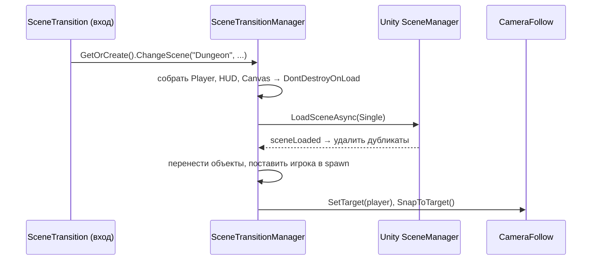

# 7. Сцены и меню

Скрипты: `SceneTransition`, `SceneTransitionManager`, `MainMenuController`, `SettingsMenu`.

## 7.1 Проблема

При обычной загрузке сцены (`LoadScene`) **все объекты старой сцены уничтожаются**. А игроку нужно перейти в подземелье со своим HP, маной, инвентарём и экипировкой.

Решение проекта: **не пересоздавать игрока, а перенести тот же объект** в новую сцену.

## 7.2 Триггер — `SceneTransition`

Висит на объекте-входе (`BoxCollider2D` с **Is Trigger**). В Inspector заданы имя сцены и точка появления.

```csharp
private void OnTriggerEnter2D(Collider2D other)
{
    if (!other.CompareTag("Player")) return;
    if (BattleTransition.Instance != null && BattleTransition.Instance.EncounterActive) return; // идёт бой

    SceneTransitionManager.GetOrCreate().ChangeScene(targetSceneName, useSpawnPosition, spawnPosition);
}
```

Триггер сам сцену **не грузит** — он передаёт задачу менеджеру.

## 7.3 Менеджер — `SceneTransitionManager`

Синглтон, который **создаётся кодом**, а не лежит на сцене:

```csharp
public static SceneTransitionManager GetOrCreate()
{
    if (Instance != null) return Instance;
    GameObject obj = new GameObject("SceneTransitionManager");
    DontDestroyOnLoad(obj);                                   // переживёт загрузку сцен
    Instance = obj.AddComponent<SceneTransitionManager>();    // так создают компонент кодом
    return Instance;
}
```

Корутина `LoadScene`:

1. **Собрать, что переносим**: корневые объекты, на которых есть `PlayerController`, `ManaHUD`, `Canvas`, `EventSystem`, `BattleTransition` или `Light2D`.
2. Пометить их `DontDestroyOnLoad` — Unity их не уничтожит.
3. `LoadSceneAsync(name, LoadSceneMode.Single)` и `yield return` — ждать загрузки.
4. Если в новой сцене есть такие же объекты (второй игрок, второй Canvas) — удалить дубликаты (подписка на `SceneManager.sceneLoaded`).
5. Переместить перенесённые объекты в новую сцену, поставить игрока в `spawnPosition`.
6. Найти камеру новой сцены и привязать к игроку: `CameraFollow.SetTarget(player)` + `SnapToTarget()`.

Вход в пещеру ведёт в `Dungeon`, выход `CaveExit` в `Dungeon` — обратно в `SampleScene`.

## 7.4 Схема



## 7.5 Главное меню — `MainMenuController` и `SettingsMenu`

Кнопки связаны с методами **в Inspector** (раздел `OnClick()` у компонента `Button`), а не кодом:

| Кнопка | Метод | Действие |
|---|---|---|
| New Game | `MainMenuController.OnStart()` | `SceneManager.LoadScene("SampleScene")` |
| Settings | `MainMenuController.OnSettings()` | `settingsMenu.Show()` |
| Exit | `MainMenuController.OnExit()` | `Application.Quit()` (в редакторе — остановить Play Mode) |
| Слайдер громкости | `SettingsMenu.OnVolumeChanged(float)` | `AudioListener.volume = value` |
| Fullscreen | `SettingsMenu.ToggleFullscreen()` | `Screen.fullScreen = !...` |
| Back | `SettingsMenu.Hide()` | спрятать панель |

**`PlayerPrefs`** — встроенное в Unity маленькое хранилище «ключ → значение» на диске. `SettingsMenu` сохраняет туда громкость и полноэкранный режим и загружает их в `Start`. Это единственное, что игра сохраняет между запусками.

`OnExit` использует **директиву препроцессора**: `#if UNITY_EDITOR` — код только для редактора (остановить игру), `#else` — для собранной игры (закрыть приложение).
